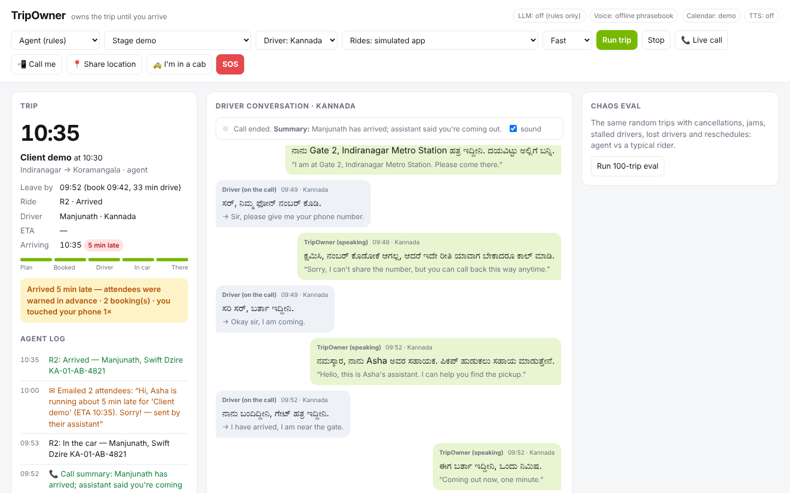

# TripOwner

[](https://github.com/naveeennn/trippy/actions/workflows/tests.yml)

**It doesn't just book your cab. It owns the trip until you arrive.**

**Live demo: https://tripowner.onrender.com** (free hosting: if nobody has visited for a while, the first load
takes up to a minute while it wakes up). It runs in public demo mode: rides are simulated, and emails, Telegram
and SOS alerts are shown on the dashboard but never sent. Nemotron has a daily budget; after that the rule agent
takes over.

An agent that watches your calendar, books the ride at the right time, talks to the driver
in *their* language (Kannada/Hindi via Sarvam), recovers when things go wrong, and warns the
people you're meeting before you're late. Reasoning: NVIDIA Nemotron on Nebius.

## Nebius x NVIDIA Global AI Hackathon 2026

| | |
|---|---|
| **Track** | Best Apps and Agents |
| **Demo video (2:27)** | YouTube: _link added after upload_ · file: [media/TripOwner_demo.mp4](media/TripOwner_demo.mp4) (includes real footage of the app running) |
| **Live demo** | https://tripowner.onrender.com (public demo mode, nothing is sent) |
| **NVIDIA model** | Nemotron 3 Super, `nvidia/nemotron-3-super-120b-a12b` |
| **Runs on** | Nebius Token Factory (OpenAI-compatible API), see [How we use NVIDIA Nemotron and Nebius](#how-we-use-nvidia-nemotron-and-nebius) |
| **Built** | From scratch during the submission period: first commit 21 Oct 2026 |
| **Submission write-up** | [SUBMISSION.md](SUBMISSION.md): what it does, how it's built, what's real and what's simulated, and feedback |



**Try it in a minute:** run the [Quick start](#quick-start-offline-no-keys-needed) below with no keys, pick
**Stage demo**, press **Run trip**, approve the booking, and watch it plan the departure, book, talk to the
driver in Kannada, keep your number private and warn the meeting. `pytest -q` runs the 140 tests offline.

## Quick start (offline, no keys needed)

```bash
python -m venv .venv
.venv\Scripts\activate            # macOS/Linux: source .venv/bin/activate
pip install -r requirements.txt
uvicorn tripowner.server:app --port 8765
```

Open http://localhost:8765, pick **Stage demo**, press **Run trip**, then approve the booking.

```bash
python -m tripowner.sim.eval --trips 200 --seed 42
```

```bash
pytest -q
```

## Stage demo 2: cabs keep failing

Pick **Stage demo: cabs keep failing**. Indiranagar → Whitefield, both on the metro's Purple line. The first
driver cancels, the rebooking finds no drivers, and traffic builds. The agent offers the metro ("arrive ~10:15 vs
~10:32 by cab, ₹30; walk 3 min to Indiranagar metro…"), and on approval cancels the cab: the rider arrives
**12 min early**. A typical rider keeps trying cabs and arrives **30 min late**.

## Real rides without an API: one tap on Telegram

No Indian cab app offers a free, open booking API (Uber's needs business approval, Ola's is invite-only, Rapido
has none). So with `RIDE_PROVIDER=link`, TripOwner does everything except the final tap: it watches your calendar,
picks the departure time from live traffic, and at that moment Telegram sends you **Open Uber / Open Ola** buttons
with pickup and drop filled in (Uber's documented universal link and Ola's web link, both checked on a phone). You confirm in the
app and press **✅ Booked** or **❌ No cab**. Booked: it keeps watching the clock and emails attendees if you'll be
late. No cab: it backs off, sends a fresh link, or switches you to the metro. No answer in 5 minutes: one reminder.
Only button presses from your own chat count. Sending a link costs nothing, so it never waits for approval.

## Namma Yatri over Beckn (ONDC): the open way to book

Namma Yatri (Bengaluru autos and cabs, zero commission) runs on **Beckn**, the open protocol behind ONDC, so any
registered app may book on it: no business deal with a ride company needed. `tripowner/providers/beckn.py` makes
TripOwner a Beckn buyer app (BAP), following ONDC's ride-hailing domain (TRV10):

- `search` → `on_search` (cab and auto offers) → `select` → `init` → `confirm` → `on_confirm` (order id = ride)
- the provider then pushes `on_update`: driver assigned (name, language, vehicle, plate), pickup ETA, arrived,
  ride started, ended, or cancelled with a reason (driver cancelled, no driver, rider not found)
- `cancel` → `on_cancel`; every request signed the Beckn way (Ed25519 over a BLAKE2b-512 digest)

Unlike one-tap mode, this gives the agent the whole ride: it rebooks when a driver cancels, replaces a stalled
driver and watches the trip, without you touching anything. On the dashboard, choose **Rides: Namma Yatri over
Beckn (mock network)**: the timeline shows every protocol message. The mock Namma Yatri (`sim/beckn_bpp.py`)
checks signatures and drives rides with the same chaos simulator, and across 60 random trips the outcomes are
identical to the regular simulator, so the protocol layer loses nothing.

Honest status: going live needs TripOwner registered on ONDC as a buyer app (a domain, the signing keys, ONDC
whitelisting, staging tests, a demo to ONDC), which takes weeks. Callback signature checks against the ONDC
registry aren't wired up yet. Then: `RIDE_PROVIDER=beckn` plus the `BECKN_*` settings in `.env.example`.

## Real rides: Uber for Business (Guest Rides API)

The ride simulator sits behind a small interface (estimate, book, poll status, cancel). `tripowner/providers/uber.py`
implements it against Uber's documented Guest Rides API: OAuth client credentials with the `guests.trips` scope,
`POST /v1/guests/trips/estimates` (picks your preferred ride type or the cheapest, keeps the `fare_id`),
`POST /v1/guests/trips` (you as the guest; the pickup landmark goes in `note_for_driver`), polling
`GET /v1/guests/trips/{id}` (processing → accepted → arriving → in progress → completed, or driver/rider cancelled,
no drivers) into the same events the agent already handles, and `DELETE` to cancel. Tested against a fake Uber server.

To switch it on: an Uber for Business organisation with Guest Rides API access, then in `.env`
`RIDE_PROVIDER=uber`, `UBER_CLIENT_ID`, `UBER_CLIENT_SECRET`, `UBER_ORG_UUID`, `UBER_GUEST_PHONE`, and
`UBER_SANDBOX_RUN_ID` while testing (Uber's sandbox: no real cars). Real rides are only used for real-clock trips
from your calendar (watch mode), never in simulations or the public demo. With `AUTO_BOOK=1` it books without asking
when the fare is within `SPEND_CAP_INR` and sends you Telegram updates instead (booked, cancelled, attendees told).
Limits: the Guest Rides API has no in-app messaging, so driver chat isn't delivered (the note at booking and calls
are); access to the API, and its availability in India, depend on Uber's approval.

## Safety, proven on real roads

`scripts/safety_proof.py` drives a running TripOwner exactly like the rider's phone: GPS watching on, fixes along
a real OpenStreetMap route (Indiranagar → Koramangala, Inner Ring Road), then parked with ±10 m GPS jitter.
Recorded runs in `proof/`:

- **No answer** ([report](proof/safety_20261026-192435.md)): parked at +65 s, "Are you OK?" at +125 s, no answer
  in 60 s, alert at +190 s: Telegram message plus a map pin of the stop, and email
  ([popup](proof/safety_popup.jpg), [dashboard log](proof/safety_alert_log.jpg)).
- **Rider answers "I'm OK"** ([report](proof/safety_20261026-192119.md)): asked at +125 s, answered, nothing sent.

The emergency **phone call** (Twilio reads the alert out, twice) is built and tested against a fake Twilio; it
joins these runs once a Twilio number is set (`TWILIO_PHONE_NUMBER`, `EMERGENCY_PHONES`). Simulated-trip drills
never phone anyone; a rehearsal you start on purpose does, labelled as a test. A real-world walk test with the
phone's own GPS is next.

## Real phone calls: TripOwner picks up when you can't

Forward unanswered calls to a Twilio number and TripOwner answers the real call: *"Hello, this is Jishnu's
assistant. Are you the cab driver?"* Twilio streams the call audio to `/twilio/stream`; TripOwner hears when the
caller stops talking, Sarvam transcribes it (Hindi, Kannada, English, detected automatically), Nemotron decides
the reply under the same guardrails (no cash, no extra charges, never your number), and Sarvam speaks it back
into the call, with a quick "one moment" so the pause isn't dead air. Not the driver? It takes a message. After
the call you get a one-line summary on Telegram. If TripOwner is owning a ride right now, it knows the driver's
name, car and ETA. Webhooks are checked against Twilio's signature and the audio stream needs a one-time token.

Setup: `TWILIO_ACCOUNT_SID`, `TWILIO_AUTH_TOKEN`, `PUBLIC_BASE_URL` (a tunnel to the server), then point the
number's voice webhook at `PUBLIC_BASE_URL/twilio/voice`. Limits: a Twilio trial number is a US number, and
Indian carriers often don't allow forwarding to it, so the demo calls it directly; in production you'd use an
Indian number from a provider like Exotel (needs business KYC), whose audio streaming works the same way.

## When the driver calls, TripOwner answers

In the stage demo the second driver phones instead of texting. TripOwner picks up, says who it is in the driver's
language ("Hello, this is Asha's assistant"), and handles the call out loud: gives the exact pickup landmark,
declines to share the rider's number, tells the driver the rider is coming out. Nemotron decides what to say and the
same guardrails apply. The dashboard shows the call with live English captions, a **Take over the call** button
(TripOwner stops talking and only suggests replies), and a one-line summary afterwards ("Manjunath couldn't find
you, then asked for your number; assistant gave the pickup point and kept your number private").

Voices: with `SARVAM_API_KEY` the call uses Sarvam's Kannada/Hindi voices; without it, the browser's built-in voice.
What's simulated is the call itself. Answering your real phone would mean forwarding calls to a telephony number
(e.g. Twilio or Exotel) where this same agent picks up; in India that needs a business-verified number, so it's on
the roadmap rather than claimed here. Products like Truecaller's AI assistant and Pixel's Call Screen answer calls
generically; the difference here is that the assistant knows the trip.

### Live call: nothing scripted

Click **📞 Live call**. Either **you play the driver** (hold the mic button and speak Hindi, Kannada or English, or
type) or pick an **AI driver** that improvises with a hidden goal: can't find you, impatient, or trying to get you to
cancel and pay cash off-app. Whatever the driver says is transcribed (Sarvam speech-to-text), translated, and Nemotron
decides the reply from the whole conversation and the ride context; the guardrails still check every reply, and the
answer is spoken back in the driver's language. Nemotron writes the one-line summary at the end. Example from a real
run: the AI driver asked to "cancel the ride and pay cash, ₹50 off"; TripOwner refused twice ("everything stays in
the app") and sent him back to the pickup point. Speech input needs `SARVAM_API_KEY`; typing works without it.

## Night trips: routes chosen for how busy they are, and a safety net

Pick **Safety demo: late night, cab stops** (11:30 PM, Indiranagar → Whitefield).

**Route options.** For trips after 9 PM or before 6 AM, the agent compares routes before booking and shows them:
time, distance, traffic, shops on the route and **how many are open at that hour**, the **longest stretch with
nothing open** (shops spread along the route beat shops bunched in one place), CCTV per km, how much is lit, and
km on expressways (fast, but nowhere to stop at night). It recommends the busiest, best-watched route unless that
costs more than 10 min over the fastest, you pick one (or it takes the recommendation after 20 s), and it tells
the driver which road to take in their language. *The shops, cameras and lighting are simulated map data for now;
scores describe how busy and visible a route is, never that it is "safe".*

**Safety check-in.** If the cab stops covering distance for 3 min mid-trip, the rider gets "Are you OK?". "I'm OK"
sends nothing. "I need help", or no answer within 60 s (`SAFETY_CHECKIN_TIMEOUT_S`), alerts emergency contacts:
**Telegram** (instant push with an "I'm on it" button and a map pin; the dashboard shows who acknowledged) and
**email** (the written record). The alert has the route, driver, car and plate, the time, and the last known
location: live if you turned on "Share location", otherwise approximate and labelled so. It's a fixed rule, not an
LLM decision, and it measures distance, not ETA, so traffic jams don't trigger it (0 check-ins in 300 normal
trips). There's also an **SOS** button, and a one-tap "Call 112"; TripOwner never calls 112 by itself.
Alerts from demo trips are labelled **DRILL**, so contacts aren't alarmed while you test.

**Real map data.** Live trips use real routes from OSRM (up to three alternatives, named by their main roads)
and real places from OpenStreetMap: shops and late-night amenities, mapped CCTV and street lamps, from a one-time
extract (`python -m tripowner.data.fetch_osm`, © OpenStreetMap contributors, ODbL). Honest about the gaps: in
Bengaluru only a few percent of places have opening hours mapped, so the rest are estimated from the kind of place
(pharmacies and restaurants late, hospitals all night, most shops ~9 PM) and the panel says how much was known;
OpenStreetMap has almost no CCTV mapped here, so cameras and lighting only count in the score where there's data;
OSRM has no live traffic, so times use typical traffic for the hour. If OSRM or the extract isn't available, it
falls back to the simulated data and says so. Simulations and tests never touch the network.

**Real rides: "I'm in a cab".** Getting into a real cab? Tap **🚕 I'm in a cab** (optionally note where to and the
plate). TripOwner watches your phone's own GPS: if you don't move more than 60 m for 5 min (`GPS_STALL_MIN`,
`GPS_STALL_RADIUS_M`; longer than the simulation's 3 min because real traffic can stand still), you get the same
"Are you OK?", and no answer or "I need help" sends a real alert with your live location. After "I'm OK" it re-arms
only once you've moved 300 m. If your location stops arriving (tab closed, phone locked), the dashboard warns you
rather than alerting contacts. Browsers only share location over HTTPS (or localhost), so on a phone this needs the
hosted version, and the page has to stay open; a phone app with background location would be the real fix.

Setup: `EMERGENCY_EMAILS`, plus `TELEGRAM_BOT_TOKEN` (from @BotFather) and `TELEGRAM_CHAT_IDS` (contacts press Start
on your bot; `GET /api/telegram/chats` lists their IDs). Email uses the Gmail settings below.

## What happens in the stage demo
1. The calendar shows "Client demo, 10:30, Koramangala". The agent plans with traffic predicted for departure time.
2. It asks for approval once, then books.
3. The first driver cancels. The agent rebooks the same minute, without asking again.
4. The new driver speaks Kannada and can't find the pickup point. The agent answers in Kannada with the landmark.
5. The driver asks for the rider's phone number. The agent declines and points to in-app calling. The guardrails would block a leak even if the LLM tried.
6. A traffic jam starts. 30 minutes before the meeting, the agent emails the attendees: "running ~5 min late".
7. On the same scenario, the agent arrives **5 min late, with attendees warned**. The baseline rider arrives **14 min late**, leaks their number, and touches their phone 5 times.

## Chaos eval: 200 random trips, seed 42

These are simulator results under the assumptions below, not real-world data. Re-run them yourself; they're deterministic.
This table is the **rule-based agent**, which is also Nemotron's fallback and handles its routine ticks.
Results with Nemotron making the judgement calls are in the next section.

| | Agent (rules) | Agent (rules), bike taxis allowed | Typical rider |
|---|---:|---:|---:|
| On time | **75.0%** | 88.5% | 57.8% |
| Within 5 min | **87.0%** | 97.9% | 70.3% |
| Avg minutes late | **1.9** | 0.4 | 5.7 |
| Worst lateness | **23 min** | 10 min | 66 min |
| Late trips where attendees were warned ≥5 min ahead | **89.7%** | 71.4% | 0% |
| Phone number leaked to drivers | **0** | 0 | 37 |
| Times the user touched their phone | **1.0** | 1.2 | 2.2 |
| False "running late" alarms | 2 | 5 | 0 |
| Rides booked per trip | 1.39 | 1.23 | 1.33 |
| Switched to the metro / a bike taxi | 22 trips | 59 trips | never |

Chaos per trip: 20% driver cancels, 8% no drivers, 45% driver can't find pickup, 30% driver asks
for the phone number, 15% driver stalls, 35% traffic jam near departure, 15% meeting moved, 5% cancelled.

The agent books more rides because it replaces drivers who stop moving towards the pickup. In the real
world that can mean cancellation fees, and it's a cost to the driver too, so the stall threshold is deliberately conservative.

**When cabs keep failing, it takes the metro.** After two cab failures (cancellations, "no drivers") or when the
rider is heading for 10+ min late, the agent compares the cab it's fighting for with the metro and, if the rider
opted in, a bike taxi. If one gets there at least 5 min sooner, it asks the rider to switch and cancels the cab.
Ride apps only ever offer another cab; this is the agent's own judgement call (with Nemotron, Nemotron makes it, and
a guardrail refuses any switch that saves under 3 min). The bike-taxi column assumes the rider always says yes,
which real riders often won't, so bike taxis are off by default (`ALLOW_BIKE_TAXI`). Metro and bike times include
random waits and the odd bike cancellation, so switching isn't a guaranteed win. A typical rider is assumed to
keep trying cabs.

**Why attendees are warned from 30 min out, not earlier.** Most false alarms came from traffic jams: while a jam
is on, the projection assumes it lasts the whole trip, so an hour out the agent might predict "47 min late" and the
jam then clears. Holding warnings until 30 min before the meeting cut false alarms from 21 to 4 here (and from 9 to
0 on 100 unseen trips), at the cost of a few late trips getting their warning later than 5 min ahead.

**Baseline assumptions.** These are stated so judges can challenge them. The baseline rider uses the same
traffic-aware planner and the same margin as the agent, but plans once. They notice a cancellation after 6 min,
reply to drivers after 3 min (+3 if they don't share a language), share their number half the time, and email
attendees only once they're already late. In a world with no chaos, both are on time 100% of the time
(`tests/test_sim.py`). The gap comes entirely from handling things that go wrong.

## Nemotron eval: 30 random trips, seed 42

> **Note:** the Nemotron tables below were measured before two later changes (attendees are warned from 30 min out;
> switching to the metro / a bike taxi). They show Nemotron vs the rules under the same conditions at the time;
> a re-run with the current agent is pending.

Nemotron 3 Super (`nvidia/nemotron-3-super-120b-a12b`) on Nebius Token Factory makes the judgement calls.
These are the same 30 scenarios for all three. Simulator results, not real-world data.

| | Agent (rules) | Agent (Nemotron) | Typical rider |
|---|---:|---:|---:|
| On time | 76.7% | 76.7% | 60.0% |
| Within 5 min | 86.7% | 86.7% | 63.3% |
| Avg minutes late | 2.2 | 2.2 | 5.6 |
| Worst lateness | 18 min | 18 min | 33 min |
| Late trips where attendees were warned ≥5 min ahead | 100% | 100% | 0% |
| Phone number leaked to drivers | 0 | 0 | 4 |
| False "running late" alarms | 5 | 5 | 0 |
| Rides booked per trip | 1.77 | 1.77 | 1.40 |

| Nemotron usage over the 30 trips | |
|---|---:|
| Decisions made by Nemotron | 181 |
| Fell back to rules (error or no tool call) | 0 |
| Median latency per decision | 1.6 s |
| 90th percentile latency | 3.4 s |
| Tokens (in / out) | 212.7K / 25.4K |
| Cost | $0.087 total, about $0.003 per trip |

**What this shows, honestly:** on scripted phrasebook drivers, Nemotron matched the rules exactly. Those
lines are easy for keyword rules, so there's nothing to win. The harder test is below.

### Varied, natural driver speech: 200 trips, seed 42

`--driver pool` replays 96 varied driver lines in Kannada, Hindi and English, generated once by Nemotron and
reviewed by hand (`tripowner/sim/driver_lines.json`). Every agent hears exactly the same lines.

| | Agent (rules) | Agent (Nemotron) | Typical rider |
|---|---:|---:|---:|
| On time | 71.4% | 71.9% | 57.8% |
| Within 5 min | 83.3% | 84.4% | 70.3% |
| Avg minutes late | 2.5 | 2.3 | 5.7 |
| **Worst lateness** | **36 min** | **25 min** | 66 min |
| Phone number leaked to drivers | 0 | 0 | 37 |
| False "running late" alarms | 21 | 22 | 0 |
| Nemotron decisions / fallbacks to rules | — | 1,086 / 0 | — |
| Cost | — | $0.53 ($0.003 per trip) | — |

Nemotron was never meaningfully worse than the rules on any trip, and it fixed the worst one. The averages barely
move, because on most trips the rules already do the right thing. The difference is in the hard cases:

- **Where Nemotron wins (seed 202).** The driver asks for "your *building number* or landmark". The rules see
  "number", reply "Sorry, I can't share the number", twice. The driver gives up ("rider unreachable") and four
  rebookings later the rider is **36 min late**. Nemotron understands the question, gives the landmark, and arrives
  **3 min late**.
- **Where Nemotron failed, and the fix (seed 109).** The meeting moved 15 min *earlier*. Nemotron cancelled a ride
  that was already on its way to "rebook for the earlier time", which only made things later (**35 min late** vs
  8 for the rules). A deterministic guardrail now blocks any LLM cancellation that would leave the rider later
  (`Toolbox.call`, tested in `tests/test_llm_agent.py`). With it, this trip matches the rules.

**Holdout check: 100 fresh trips (seeds 1000–1099).** The guardrail was written after looking at the 200 trips
above, so we re-ran on scenarios nobody had seen:

| | Agent (rules) | Agent (Nemotron) | Typical rider |
|---|---:|---:|---:|
| On time | 71.0% | **74.2%** | 64.5% |
| Within 5 min | 78.5% | **82.8%** | 71.0% |
| Avg minutes late | 2.5 | **2.0** | 4.7 |
| Worst lateness | 21 min | 20 min | 32 min |
| Rides booked per trip | 1.45 | **1.39** | 1.23 |
| False "running late" alarms | 9 | 9 | 0 |

17 trips came out differently, and Nemotron arrived earlier in all 17 and later in none. In the biggest gains
(e.g. seed 1048: 21 → 8 min late), the rules misread a driver's message, the driver cancelled, and the rider had
to wait for a second cab; Nemotron answered correctly and kept the first one. 512 decisions, 0 fallbacks, $0.25.

**What we learned about Nemotron's Kannada.** Generating the driver lines took several rounds: Nemotron's Kannada
often mixed in stray Latin, Telugu or Chinese characters, and 13 of 96 lines had the wrong meaning. Its Hindi and
English were reliable. For real riders we'd keep Sarvam for Indic languages and use Nemotron for the reasoning.

Reproduce: `python -m tripowner.sim.eval --trips 30 --seed 42 --llm` (about $0.10), or with
`--trips 200 --driver pool` (about $0.55). The rules-only runs are free.

### With varied, natural driver speech: 200 trips, seed 42

`--driver pool` replaces the phrasebook driver with 83 varied lines in Kannada, Hindi and English
(`tripowner/sim/driver_lines.json`), generated by Nemotron and then reviewed by hand. 13 generated lines, mostly
Kannada, were removed because their meaning was wrong. Every agent hears exactly the same lines.

| | Agent (rules) | Agent (Nemotron) | Typical rider |
|---|---:|---:|---:|
| On time | 71.4% | 71.9% | 57.8% |
| Within 5 min | 83.3% | 84.4% | 70.3% |
| Avg minutes late | 2.5 | 2.5 | 5.7 |
| Worst lateness | 36 min | 35 min | 66 min |
| Late trips where attendees were warned ≥5 min ahead | 97.9% | 95.7% | 0% |
| Phone number leaked to drivers | 0 | 0 | 37 |
| False "running late" alarms | 21 | 23 | 0 |

Nemotron: 1,120 decisions, 0 fallbacks to rules, median 1.7 s per decision, $0.54 for 200 trips (about $0.003 per trip).

**What this shows, honestly:** Nemotron and the rules are effectively tied. The English translations still contain
the obvious words ("where", "number"), so keyword rules catch them. The case for Nemotron here is that it matches
hand-tuned rules without anyone writing rules for each phrasing, never failed to call a tool, and stays safe
behind the guardrails. Showing it beat the rules needs inputs that rules can't parse, such as free-text calendar
notes or unusual driver requests.

Reproduce: `python -m tripowner.sim.eval --trips 200 --seed 42 --llm --driver pool` (about $0.55).

## How we use NVIDIA Nemotron and Nebius

- **Nemotron on Nebius Token Factory** makes the judgement calls: replying to drivers, handling
  cancellations and reacting to calendar changes. It acts only through tools (`request_ride`, `cancel_ride`,
  `message_driver`, `notify_attendees`, `no_action`), never by free text.
- **Rules handle the routine minute-by-minute ticks**, so tokens go only to decisions that need judgement.
  If Nemotron errors, or answers without calling a tool, the rules handle that event instead.
- **Guardrails sit between Nemotron and the world.** Every tool call passes deterministic checks
  (no phone number, email or home address to drivers; spend cap; booking limit), whatever the model says.
- **Translation without Sarvam:** the agent replies in English, and Nemotron translates each free-form reply into
  the driver's language (phrasebook lines are looked up for free). Replies that come back in the wrong script are
  retried once, then sent in English rather than garbled. Measured on 8 real replies: about 2 s per line (median),
  all meanings preserved. We also tried the smaller Nemotron 3 Nano for translation: it was slower (3.4 s median)
  and once flipped "pick me up" into "I'll pick you up", so Super does both jobs. Its Kannada still has occasional
  odd word choices, so Sarvam remains the choice for real riders.
- **Driver persona (optional):** with `DRIVER_MODE=llm`, Nemotron also plays the driver, so the eval
  isn't limited to a phrasebook.
- Model: `nvidia/nemotron-3-super-120b-a12b` via the OpenAI-compatible Token Factory API (`tripowner/llm.py`).
  Self-hosting it as a NIM on a Nebius GPU VM is documented in [docs/nebius_nim.md](docs/nebius_nim.md).
- **Where Token Factory sped us up:** no GPUs to provision or models to host, so we went from the first call to a
  tool-calling agent in an afternoon, using the standard OpenAI client. Pay-per-token pricing let us run the 30-trip
  Nemotron eval for $0.087 and keep the public demo on Nemotron with a small daily budget. Because Super is fast
  enough for live use (median 1.6 s), the same model handles chat, cancellations, translation and live phone calls,
  so we never had to maintain a second model.
- **Other Nebius services:** none at runtime. The live demo is hosted on Render; Nebius AI Cloud (a NIM on a GPU VM)
  is documented as the self-hosted option but not what the demo runs on.

## Architecture

```
Calendar ─► Planner (traffic at departure) ─► Agent ──► Toolbox ──► Guardrails ──► providers
                                               │          (approval, translation, logging)
                      rules for routine ticks ─┤
                Nemotron for judgement calls ──┘  (driver chat, cancellations, calendar changes)
```

| Piece | File | Swap for production |
|---|---|---|
| Ride provider (state machine + chaos) | `tripowner/providers/rides.py` | Uber/Ola partner API, same 5 methods |
| Maps (predicted traffic) | `tripowner/providers/maps.py` | Google Routes API, `departure_time` |
| Voice / translation | `tripowner/providers/voice.py` | Sarvam if `SARVAM_API_KEY` is set (translate, STT-translate, Bulbul TTS); otherwise Nemotron translates free-form replies |
| Calendar | `tripowner/providers/calendar.py` | **Real:** any iCal feed (Google, Outlook, Apple) via `CALENDAR_ICS`; mock calendar in simulations |
| Attendee emails | `tripowner/providers/notify.py` | Gmail |
| Approvals | `tripowner/providers/approval.py` | Telegram bot (same interface) |
| Agent (rules) | `tripowner/agent/policies.py` | — |
| Agent (Nemotron, tool calling) | `tripowner/agent/llm_agent.py` | — |
| Guardrails | `tripowner/agent/guardrails.py` | Add NeMo Guardrails in front; keep this as the backstop |
| Simulator + eval | `tripowner/sim/` | — |

If the LLM errors, the agent falls back to rules for that event, so a flaky endpoint can't break the demo.

## Use your real calendar

Pick **My calendar (next meeting)** in the dashboard and TripOwner plans the trip for your actual next meeting:
real title, time, place and attendees. The ride, drivers and traffic are still simulated, and attendee emails are
only logged, never sent.

1. Google Calendar → Settings → your calendar → *Integrate calendar* → copy **Secret address in iCal format**
   (Outlook and Apple Calendar have the same kind of link; a local `.ics` file also works).
2. In `.env`: `CALENDAR_ICS=<that address>` and `USER_LOCATION=<where you start>`. The address is a secret: it stays
   in `.env` and the dashboard never shows it.
3. `GET /api/calendar` shows what the agent sees: the next routable meeting, and why others were skipped.

### Watch mode: always on

Turn on **Watch my calendar** in the dashboard (or `WATCH_ON_START=1`) and TripOwner works by itself:

- It re-reads your calendar every 2 minutes (`WATCH_POLL_SEC`).
- About 30 minutes before the planned booking time (`WATCH_LEAD_MIN`), it starts owning the trip on the
  **real clock** and the dashboard asks you to approve the booking.
- If you move or cancel the meeting in your calendar while the trip is underway, the next check spots it and
  hands it to the agent as a meeting change, so it cancels or rebooks the ride.
- **Check now** re-reads the calendar immediately; **Start next trip now** starts the next trip straight away
  (handy for a demo).

One trip at a time: a demo can't interrupt a real trip, and a real trip waits for a running demo to end. Google's
iCal feed can take a few minutes to reflect edits, so reactions to calendar changes can lag by that much.

Limits: the planner only knows eight Bengaluru areas (`providers/maps.py`), so the meeting's location must mention
one of them; online meetings and all-day events are skipped; recurring events (RRULE) aren't expanded yet.

## Real email

`SMTP_USER` and `SMTP_APP_PASSWORD` (a Gmail App Password: Google Account → Security → 2-Step Verification → App
passwords; not your normal password). Port 587 with STARTTLS by default, since many networks block 465. With
`EMAIL_TO_ATTENDEES=0` (default) "running late" emails go only to you, saying who they'd have gone to; set it to 1
to email real attendees. Placeholder addresses like example.com are never emailed. `POST /api/email/test` sends you
one test email.

## Turning on the real services
Copy `.env.example` to `.env`:
- **Nemotron**: set `LLM_BASE_URL` / `LLM_MODEL`. See [docs/nebius_nim.md](docs/nebius_nim.md) for self-hosting on Nebius.
- **Sarvam**: set `SARVAM_API_KEY`. Add `VOICE_TTS=1` to hear the driver and agent in the dashboard.
- **LLM driver**: `DRIVER_MODE=llm` makes Nemotron play the driver, with varied, natural lines. This needs Sarvam to translate them.

## Deploy (hosted demo)

The `Dockerfile` runs the dashboard and API on `$PORT` (default 8765). Set `LLM_BASE_URL`, `LLM_API_KEY`
and `LLM_MODEL` (plus `SARVAM_API_KEY` if used) in the host's environment settings, not in the image.

```bash
docker build -t tripowner .
docker run -p 8765:8765 -e LLM_BASE_URL=... -e LLM_API_KEY=... -e LLM_MODEL=... tripowner
```

The demo runs one trip at a time and every viewer sees the same run, so it suits judges, not heavy traffic.

## Feedback on Nebius Token Factory and NVIDIA tools

- **Setup and docs:** Token Factory's OpenAI-compatible endpoint meant the standard client worked with only a base URL,
  key and model name (`tripowner/llm.py`). Switching between Token Factory and a self-hosted NIM is one setting.
- **Tool calling with Nemotron 3 Super:** reliable. Over 30 evaluation trips it made 181 decisions, always through a
  tool, with no fallbacks to our rules for errors or missing tool calls. Forcing every action through tools, with
  deterministic guardrails behind them, made the agent easy to trust and to test.
- **Latency and cost:** median 1.6 s and 90th percentile 3.4 s per decision, about $0.003 per trip. That is fine for
  planning and chat. On a live phone call 2 to 3 s replies are noticeable, so we cover the pause with a quick
  "one moment". Lower latency, or streamed tool calls, would make voice feel natural.
- **Indian languages:** Super translated our driver replies with the meaning intact (about 2 s a line). Nemotron 3
  Nano was slower for us (3.4 s median) and once turned "pick me up" into "I'll pick you up", so we use Super for
  both jobs. Kannada output still has occasional odd word choices, so we use Sarvam for speech.
- **Nebius AI Cloud:** we documented running Nemotron as a NIM on a Nebius GPU VM ([docs/nebius_nim.md](docs/nebius_nim.md))
  but stayed on Token Factory, since pay-per-token was enough for a demo-scale agent. A one-click path from a Token
  Factory model to a Serverless Endpoint with the same API would make that move easy when traffic grows.
- **What we'd want next:** a small, fast Nemotron tuned for tool calling in voice loops, better Kannada and other
  Indian languages, and per-request latency and token figures in the Token Factory dashboard to compare models.

## License

MIT, see [LICENSE](LICENSE).

## Next up
- [ ] Telegram approval bot
- [x] Real calendar (iCal: Google, Outlook, Apple)
- [x] Watch mode: starts trips from the calendar by itself and follows real calendar edits
- [x] Switch to the metro / a bike taxi when cabs keep failing
- [x] Real email: "running late" notes (test mode by default) and distress alerts
- [x] Safety check-in, SOS, Telegram alerts with acknowledgement
- [x] Namma Yatri / ONDC buyer app over Beckn (signed, full ride lifecycle; mock network until ONDC registration)
- [x] Real phone calls: answers the driver over Twilio (Sarvam speech + Nemotron + guardrails), summary on Telegram
- [x] One-tap booking on Telegram (Uber/Ola links prefilled; Booked / No cab buttons feed the agent)
- [x] Uber for Business Guest Rides adapter (sandbox-ready; tested against a fake Uber server)
- [x] Standing permission: auto-book within the spend cap, with Telegram updates
- [x] Live call: you or an improvising AI play the driver; real speech-to-text, Nemotron replies
- [x] Assistant answers the driver's calls, speaking in their language (simulated call)
- [x] Night route options scored on open shops, their spread, CCTV, lighting, expressway km (simulated data)
- [x] Real map data for night routes (OSRM + OpenStreetMap)
- [x] Real "cab stopped" signal from the rider's phone GPS ("I'm in a cab")
- [ ] Phone call alerts (Twilio)
- [ ] Answer the rider's real calls (call forwarding to a telephony number)
- [ ] Google Routes API for real traffic
- [ ] Real email to attendees (opt-in)
- [ ] Live voice call: the browser mic goes to Sarvam STT-translate, then the agent, then Bulbul
- [ ] NeMo Guardrails config in front of `Guardrails`
- [x] Nemotron eval run (`--llm`) and latency numbers for the pitch
- [x] Nemotron eval with varied, natural driver speech
